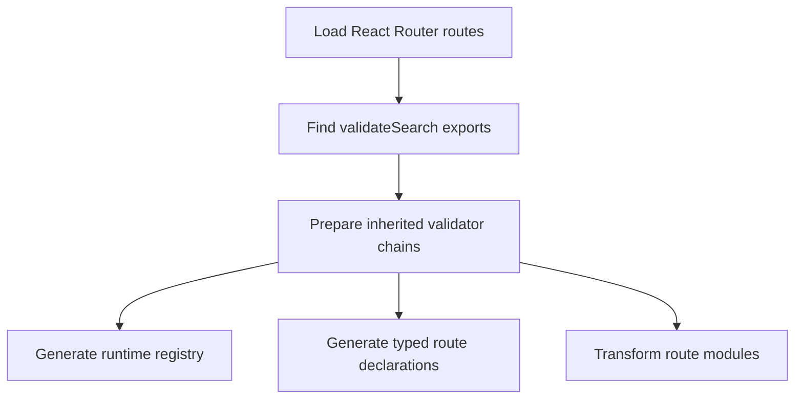
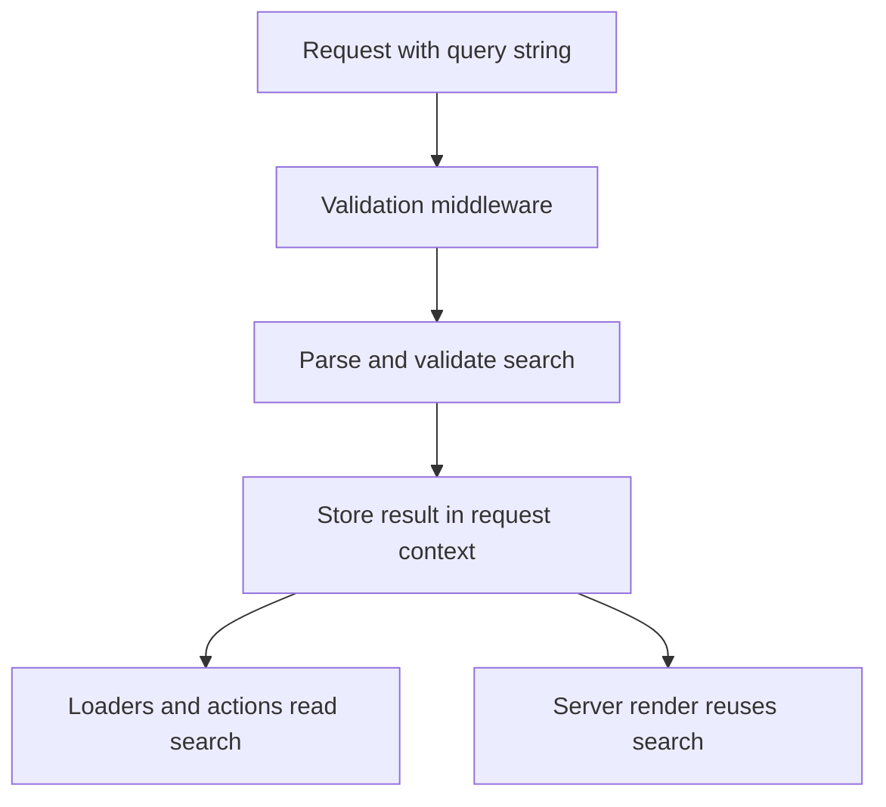
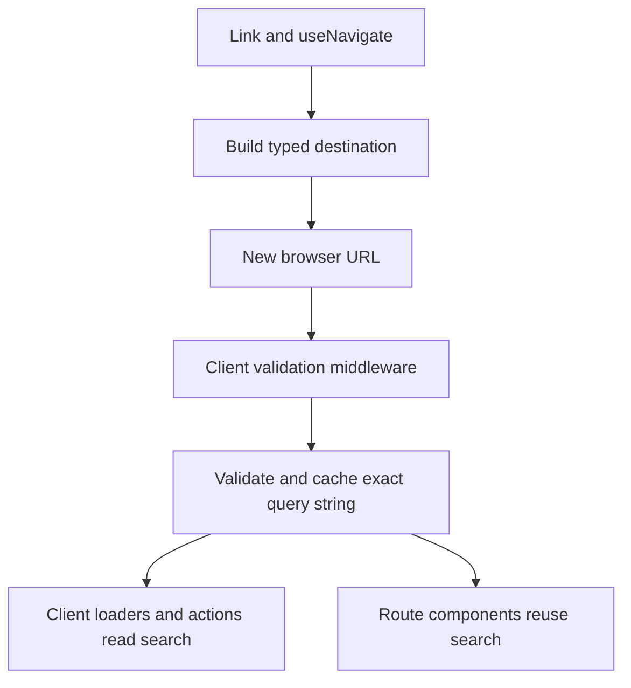

# Contributing to `react-router-validated-search`

The package targets React `>=19.2.7 <20`, React Router `>=8.2.0 <9` Framework Mode, and Vite 8. It turns a route's `validateSearch` export into runtime `search` for handlers/components and typed search for `Link`/`useNavigate`. The floor stays at 8.2 because that release fixed dynamic-param URL encoding in `href()` and added the adapter-neutral default server entry used by the zero-config Framework Mode fixture.

The [README](README.md) owns public usage, API examples, and migration guidance. This document owns implementation structure, invariants, review decisions, and required regression checks.

## Before you start

Use the repository development toolchain enforced by `package.json`:
Node `>=24.11.0 <25` and pnpm `11.22.0`.

```sh
vp install
```

Commands below assume the repository root as the working directory.

Enable the repository's staged-file formatter once per clone:

```sh
vp hooks enable
```

## Development loop

Use tests and typecheck as the fast feedback loop:

```sh
vp run check
vp test
vp run typecheck
```

Tests are colocated with source files. Add the smallest regression test beside the changed module. Cross-boundary behavior belongs in `test/framework-fixture.test.ts` or the framework fixture's `type-contracts.tsx`.

## Where to make a change

| Change                      | Start here                                                                | Regression checks                             |
| --------------------------- | ------------------------------------------------------------------------- | --------------------------------------------- |
| Raw parsing or codecs       | `src/runtime/flat-search-codec.ts`, `src/runtime/json-search-codec.ts`    | codec tests                                   |
| Validation or errors        | `src/runtime/validate-search.ts`, `src/runtime/route-validation.ts`       | validation/middleware tests                   |
| Parent/child inheritance    | `src/vite/route-config.ts`, `src/runtime/route-validation.ts`             | route-config/middleware tests                 |
| Handler/component injection | `src/vite/analyze-route.ts`, `src/vite/transform-route.ts`                | transform tests, framework fixture, app build |
| Component revalidation      | `src/react/component.tsx`                                                 | component tests, framework fixture            |
| Typed links/navigation      | `src/react/route-types.ts`, `src/react/link.tsx`, `src/react/navigate.ts` | React/type-contract tests                     |
| Generated `+types`          | `src/vite/typegen.ts`, `src/vite/registry.ts`                             | typegen tests, fixture typecheck              |
| Vite/HMR                    | `src/vite/plugin.ts`, `src/vite/scan-routes.ts`                           | plugin/scan tests, fixture build              |
| Package exports/build       | `package.json`, `vite.config.ts`                                          | package build, clean app build                |

## Before opening a merge request

Build the package and run the repository formatting and lint checks for source changes:

```sh
vp run check
vp run build
```

Transform, registry, typegen, or package-boundary changes also require the real application checks. Unit tests cannot reproduce React Router export pruning, route chunking, or SSR/client bundling:

```sh
vp run typecheck
vp test
```

- If public validation, inheritance, navigation, or serialization behavior changed, update the README and its examples.
- Do not edit generated `.react-router-validated-search/` or `.react-router/types` files. Change the generator and its tests instead.

## Entry points

| Entry              | Audience                                                  |
| ------------------ | --------------------------------------------------------- |
| `.`                | Everything a consumer writes by hand.                     |
| `./internal`       | Everything this package's own generators emit imports of. |
| `./internal/codec` | The codec implementations, for the virtual codec module.  |
| `./vite`           | `typedSearch()` and `TypedSearchOptions`.                 |

The transform and the shadow `+types` import from `./internal`, so middleware factories, context helpers, the component wrapper, and chain inference stay out of the root entry. Nothing under `./internal` is part of the public contract; it may change with the generators. A symbol only used inside `src` is exported from neither — its own module is enough.

The codecs sit on their own entry because the middleware and the component wrapper read the virtual codec module: serving both from one entry would make that module import itself back, and a cycle only stays harmless while nothing in it runs at module top level.

Because every alias key also matches everything below it, an alias table that points the package at `src` lists the deeper subpath first. Otherwise `react-router-validated-search/internal/codec` resolves to `src/internal/index.ts/codec`.

## Execution model

Read this and the following invariant sections before changing behavior that crosses runtime, React, Vite, or generated-type boundaries.

One route module may belong to only one search-aware route record. The transform embeds route-specific validation IDs in that module, so `prepareSearchRoutes` rejects shared files when the affected routes declare or inherit validation, instead of letting the last route silently win.

### Build pipeline



`plugin.ts` runs this pipeline and refreshes it during HMR. One `PreparedSearchRoute` model feeds the registry, type generation, and source transform. Plugin order is mandatory:

```ts
plugins: [typedSearch(), reactRouter()];
```

The transform must also process React Router's `?route-chunk=...` and `?__react-router-build-client-route` requests. Different source shapes between passes cause dropped exports.

### Server request



The server never caches validated search between requests. Without `ValidatedSearchProvider`, the render validates again instead of sharing data across requests.

### Browser navigation



Client middleware validates every navigation, including routes without data. The cache only prevents the following render from running the same validator against the same query string again.

### Module ownership

| Responsibility                 | Module                            |
| ------------------------------ | --------------------------------- |
| Vite lifecycle and HMR         | `src/vite/plugin.ts`              |
| Route tree and inherited model | `src/vite/route-config.ts`        |
| Route export scanning          | `src/vite/scan-routes.ts`         |
| Runtime registry generation    | `src/vite/registry.ts`            |
| Shadow route declarations      | `src/vite/typegen.ts`             |
| Route source transformation    | `src/vite/transform-route.ts`     |
| Parse, cache, and route chains | `src/runtime/route-validation.ts` |
| Execute one validator          | `src/runtime/validate-search.ts`  |
| Request context                | `src/runtime/middleware.ts`       |
| Component search               | `src/react/component.tsx`         |
| Typed destination              | `src/react/href.ts`               |

### Server details

```text
validation middleware
  -> parse request once
  -> validate local contract
  -> merge parent + local result
  -> store by route id in RouterContextProvider
  -> user middleware
  -> loader/action wrapper reads context
  -> user handler receives { ...args, search }
  -> handleRequest receives the same context as its fifth argument
  -> ValidatedSearchProvider puts it in React context
  -> component wrapper reads it by route id
```

Validation middleware is prepended to route middleware. Server handlers reuse its result; they do not validate again.

The last three steps are opt-in and belong to the application's `entry.server.tsx`. Without them the component wrapper validates the location itself, which is correct but repeats work — see [Why both pipelines exist](#why-both-pipelines-exist).

### Browser

```text
client validation middleware
  -> parse the location
  -> validate the local contract
  -> merge parent + local result
  -> store by route id in RouterContextProvider and validator cache
  -> user client middleware
  -> clientLoader/clientAction wrapper reads context
  -> component wrapper reuses the validator cache
```

React Router runs client middleware for every client navigation, including component-only routes, so the transform must not add a validation-only loader. The component wrapper keeps fallback validation for initial hydration and direct validator use, where middleware context is unavailable. That validation is synchronous and never suspends. The route-pattern form of the wrapper suspends through React `use` while the registry imports validator modules; those imports are memoized per route path, so the same promise is returned until the modules are in memory and nothing suspends afterwards.

### Why both pipelines exist

A document load validates the same string more than once: server middleware, the server render of the component wrapper, and the browser render after hydration. The wrapper recomputes from `location.search` because a component cannot read middleware context: React Router hands `RouterContextProvider` to middleware, loaders, and actions only. One place does receive it — `handleRequest` in `entry.server.tsx` takes it as its fifth argument — and `ValidatedSearchProvider` passes it from there into the render, so the wrapper reads what middleware stored instead of validating again.

This is opt-in, because `entry.server.tsx` belongs to the application. The wrapper works either way, and it uses a stored result only when the route id matches and the middleware validated exactly the search string being rendered. The Vite transform knows that route id — the deepest route in the chain that declares `validateSearch` — and passes it to `withValidatedSearch` as a third argument. `useValidatedSearch('/pattern')`, called by hand, receives a URL pattern instead and validates on its own.

In the browser the wrapper costs nothing extra, because client middleware fills the validator cache it reads. On the server there is no such cache, so without the provider the render always validates again — see [Caching](#caching). What that costs grows with the chain: middleware runs each validator once, while the wrapper of every route runs its whole inherited chain, so a chain of `N` routes means `N` middleware passes against `N(N+1)/2` render passes.

Server and browser validating separately, on the other hand, is deliberate — each side computes from the input it actually received:

- Server: the trust boundary. Search comes from the user, so no handler may see unchecked input, and only here does a schema failure become HTTP 400 or a `validateSearch` redirect become a document redirect.
- Browser: `location.search` is the only source of truth, and the server does not take part in a client navigation to a route without server data. A `Response` thrown while rendering is not a redirect either — the middleware pipeline handles responses, the render path does not.
- Handing the result over from the server is not on the table: middleware context is not serialized to the client, and routing it through loader data would cap validator output at serializable values, miss data-less routes, and let a component render search that disagrees with the URL.

What one pass costs is not this package's to state: the route exports the validator, and it can be a schema or any function. So reach for the provider on a measurement of the application, not on the count of passes alone — and do not "optimize" this into a single pass without also answering the three points above.

## Validation contract

| Topic                   | Contract                                                                                                                                           |
| ----------------------- | -------------------------------------------------------------------------------------------------------------------------------------------------- |
| Flat codec input        | No coercion. Repeated keys are arrays; empty strings and unknown keys survive. Never use `Object.fromEntries`.                                     |
| JSON codec input        | Each top-level value is decoded independently; repeated keys become arrays and unknown keys survive.                                               |
| Standard Schema success | Return `result.value` unchanged.                                                                                                                   |
| Standard Schema issues  | Throw `SearchValidationError`; data handlers convert it to HTTP 400, component validation reaches the route error boundary.                        |
| Function validator      | Result and thrown redirects/responses/errors pass through unchanged.                                                                               |
| Promise result          | Rejected with a thrown `Error`, for a Standard Schema and a function alike. See [Synchronous validation](#synchronous-validation).                 |
| Fallback/redirect       | Owned by the schema (`.catch()`) or function, never invented by the library.                                                                       |
| Return value            | Must be defined, normally an object. `undefined` is the internal missing-result sentinel. `null` is a valid result but not useful for inheritance. |
| Client boundary         | `validateSearch` is client-visible; it must not import `.server` modules or server-only barrels.                                                   |

Flat raw input examples:

```text
?page=2       -> { page: "2" }
?tag=a&tag=b -> { tag: ["a", "b"] }
?q=          -> { q: "" }
```

Unknown keys are preserved into validation, not necessarily in schema output. A migrated route that previously retained them must use schema passthrough or explicitly merge `{ ...raw, ...parsed }`. Thrown response status, headers, and `Location` are preserved. Redirect localization belongs to application middleware.

### Synchronous validation

Validation is part of route rendering, so `runSearchValidator` rejects a promise at runtime. Validator-module imports may suspend once and are memoized by route; validator execution itself must remain synchronous. Async work belongs in a loader, `clientLoader`, or middleware.

Middleware factories still return `async` functions even though nothing in them awaits: React Router has always received a promise from them, and a validator throwing synchronously instead would change where the throw surfaces in its pipeline.

## Inheritance

Validators run outermost ancestor first. Each receives the original decoded search input; their results are accumulated independently:

```ts
search = { ...parentSearch, ...childSearch };
```

- child fields override collisions;
- child route handlers and components receive accumulated parent results;
- parent route handlers and components never receive child-only fields;
- a route without a local validator inherits without adding middleware;
- a route with no local or inherited validator is untouched.

`InferValidatedSearchChain` and `InferSearchInputChain` must mirror the runtime merge.

## Fragile transform invariants

| Do not break                                                                      | Reason                                                                           | Guard                      |
| --------------------------------------------------------------------------------- | -------------------------------------------------------------------------------- | -------------------------- |
| Wrapped exports require local bindings; re-exports are rejected.                  | There is no safe local declaration to rewrite.                                   | transform tests            |
| Validation middleware stays first.                                                | Context must exist before consumers run.                                         | middleware/transform tests |
| Server handlers read context.                                                     | Revalidation changes behavior and cost.                                          | handler/middleware tests   |
| Client wrappers copy function properties.                                         | React Router reads `clientLoader.hydrate` from the exported function.            | hydrate test               |
| `Object.assign` stays inside client wrapper declarations.                         | A top-level call retains server handlers and `.server` imports in client builds. | fixture + app build        |
| Server wrappers do not copy properties.                                           | React Router must be able to remove their dependency graph.                      | framework fixture          |
| Original component declarations stay exported.                                    | Otherwise React Router can lose independent `HydrateFallback` chunks.            | fixture chunk assertions   |
| Validation-only loader is limited to routes with neither loader nor clientLoader. | A server loader beside clientLoader changes hydration data behavior.             | transform/fixture tests    |
| Virtual module declarations have no top-level imports.                            | Imports turn ambient modules into augmentations.                                 | package typecheck          |

## Types and navigation

- Handler/component `search` uses Standard Schema output.
- `Link.search` and navigation input use Standard Schema input.
- Function validators use their return type for both because they expose no input type.
- For coercing schemas with `unknown` input fields, `InferSearchInput` substitutes output field types.

`Link` and `useNavigate` delegate rendering and navigation to React Router, but accept only registered typed destinations:

```ts
navigate(to, options?);
navigate(delta);
```

An updater receives parsed current search and returns serializable input. It validates the current query against the target route; targeting another route may load its chunk and may reject the current query. Consumers use React Router's native exports when they intentionally need an untyped destination. History deltas remain supported because they do not construct a destination.

## Shadow types

React Router writes `.react-router/types`; this package writes matching files under `.react-router-validated-search/types`. `rootDirs` must resolve the search layer first:

```json
{
  "rootDirs": [".", "./.react-router-validated-search/types", "./.react-router/types"]
}
```

Only these React Router aliases gain `{ search: Search }`:

- `LoaderArgs`;
- `ActionArgs`;
- `ClientLoaderArgs`;
- `ClientActionArgs`;
- `ComponentProps`.

`Search` is derived by TypeScript from `typeof import(route).validateSearch`; AST code never infers schema types. The route -> `+types` -> route cycle is type-only.

Generate in order:

```sh
react-router typegen
react-router-validated-search typegen
tsc --noEmit
```

The generated manifest owns stale-file cleanup. Deletion must remain restricted to `.react-router-validated-search`.

## Release checks

Run the same source checks as CI before changing the release workflow:

```sh
vp install --frozen-lockfile
vp run check
vp run build
vp run typecheck
vp test
vp pm audit -- --prod --audit-level high
```

CI then packs the package and installs that tarball into
`test/fixtures/consumer`. `Publish npm` is manually dispatched. Its first run
uses the `NPM_TOKEN` GitHub secret because npm can configure a Trusted Publisher
only after the package exists; then configure the repository-to-`publish.yml`
Trusted Publisher link in npm and remove the secret for tokenless OIDC releases.

## Caching

| Cache         | Key                             | Scope         | Purpose                                           |
| ------------- | ------------------------------- | ------------- | ------------------------------------------------- |
| Request parse | `Request`                       | one `Request` | Parse the URL once.                               |
| Validator LRU | validator + exact search string | browser only  | Share client middleware and component validation. |
| Route chain   | route path                      | module        | Import validator modules once per route.          |

The validator LRU holds 50 entries and caches successful object results only. Validators must return an object; `null`, primitives, and arrays fail before reaching the cache. It is disabled outside the browser by `typeof document === 'undefined'` in `validateSearchSource`. `route-validation.test.ts` guards the server no-cache behavior in the node environment, while `route-validation.browser.test.ts` guards the browser's positive cache semantics. The operation owns parsing and its exact search-string key, so middleware, render, and updater navigation cannot disagree about the configured codec or assemble cache behavior themselves.

There is no server-side cache of validated search, and adding one would not be an optimization but a decision to keep what one user sent within reach of the next request. The number of distinct search strings is unbounded — reordering the same parameters already produces another key — so such a cache either overflows its limit or grows without one, in exchange for skipping a synchronous schema pass. The server reuses middleware results through `ValidatedSearchProvider` instead, which lives and dies with the request, and validates again where the provider is absent.

The route chain memo is a different thing despite living at module scope too: it holds imported modules, is keyed by route path rather than by anything a request carried, and is bounded by the number of routes. A failed import is removed from it so it is not replayed to every later render.

## Codec invariants

- `parse` and `stringify` are selected together through the generated virtual codec module.
- `flat` serializes primitives and arrays; arrays become repeated keys, `undefined` is omitted, and nested values and `null` throw.
- `flat` parsing must preserve empty strings and accumulate repeated keys. Do not replace it with `Object.fromEntries`.
- `json` follows a JSON-first format: ordinary strings stay unquoted, while strings parseable as numbers, booleans, `null`, arrays, or objects are JSON-quoted to preserve their type.
- `json` encodes each top-level value independently and preserves JSON-compatible numbers, booleans, arrays, and plain objects when parsed.
- `json` rejects bigint, non-finite numbers, class instances, functions, symbols, and cycles.
- Each supported serialization example must parse back into the documented validator input.

Generated input types and runtime serialization must name the same codec, so the codec has exactly one owner: `typedSearch({ codec })`. The plugin publishes the resolved value on `plugin.api`, and the CLI reads it with `loadConfiguredCodec()`, which evaluates the config file without running a single plugin hook. The default lives in `DEFAULT_SEARCH_CODEC` and is applied by `typedSearch()` alone — `loadConfiguredCodec()` throws when it finds no configuration or no plugin in it, because a silent `flat` for a `json` application is the mismatch this ownership exists to prevent.

An externally visible codec change requires runtime tests, generated type-contract tests, and matching parsing/serialization examples in the README.

## Review decisions

1. Route API is the named `validateSearch` export; no custom route DSL.
2. Standard Schema returns parsed output; `issues` are errors, not loader data.
3. Schema `.catch()` and function validators own fallback/redirect behavior.
4. Route migrations preserve strictness, defaults, status, headers, locale, unknown-key behavior, URL shape, and scroll behavior unless explicitly changed.
5. Standard Schema input/output types remain distinct.
6. Child routes inherit parent search and override collisions.
7. `validateSearch` remains client-safe.
8. `Link`/`useNavigate` require registered typed destinations; native React Router exports remain the explicit escape hatch. `navigate(delta)` stays supported.
9. Discovery uses the real route config, not filesystem naming.
10. React Router generated files are never patched; search types live in a shadow layer.
11. Generated code imports from `./internal`, so the root entry stays the interface a consumer writes against.
12. The codec is named once, in the Vite plugin options; the CLI reads it from the configuration instead of taking a flag, and fails when it cannot. A second place to declare it is a second answer to keep in sync, a manifest of past runs cannot tell a disagreement from a coordinated change, and a fallback default turns the same mismatch into silence.
13. Server and browser each validate what they received; the result is never transferred between them. Repeated validation of one search string is accepted in exchange for the trust boundary, working redirects on both sides, and an unrestricted validator output type.
